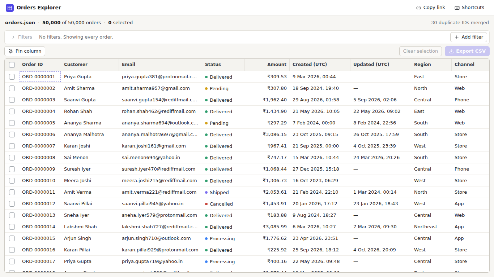
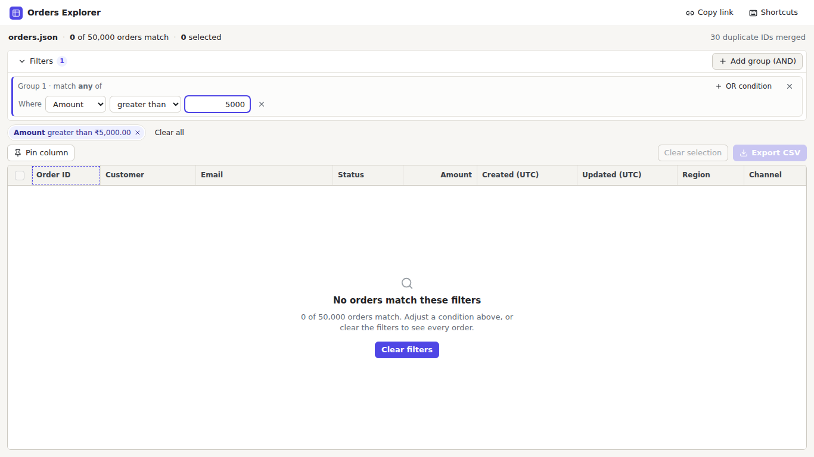

# Orders Explorer

One screen with a custom virtualised data grid (~50,000 orders) and a custom filter builder, kept in sync through the URL. React + TypeScript + Vite. The grid, the virtualiser and the filter builder are written from scratch (no table, virtualisation or query-builder library).

## 1. How to run it

Needs Node.js 24 and npm.

```bash
npm install
npm run dev        # http://localhost:5173
npm run build      # type-check + production build into dist/
npm run preview    # serve the production build, http://localhost:4173
```

## 2. Screenshots

Main screen with data:



Empty state (a filter that matches nothing):



## 3. Dependencies

Runtime:

- `react`, `react-dom`: the UI framework.
- `lucide-react`: icons (sort arrows, pin, close, etc.).

(Build tooling only: `vite`, `@vitejs/plugin-react`, `typescript`, `@types/react`, `@types/react-dom`.)

## 4. Data loading

- `orders.json` is **unmodified** and sits in `public/data/`. It is **fetched at runtime** (`src/lib/loadOrders.ts`) instead of being imported into the bundle.
- Why: a 17 MB file would bloat the JS bundle and delay the first paint. Fetching keeps the bundle small (~86 kB gzipped), shows a loading state straight away, and lets the browser cache the file separately.
- It is parsed and cleaned once in `src/lib/normalize.ts`, following `data-notes.md`: the four date formats become one UTC timestamp, v1 amounts (paise) are converted to rupees, `customer_name`/`customerName` are merged, casing and whitespace are fixed, missing `updatedAt`/`priority` stay empty (priority shows as "None"), and the 30 duplicate IDs are resolved with the notes' rule (later `updatedAt` wins). Result: **50,000 unique orders**.
- Trade-off: parsing happens on the main thread (about 2 s on localhost). I did not add a Web Worker.

## 5. The 200 rows question

**Choice: Export gives all 200.** The selection is a set of order IDs and is never changed by filtering or sorting. Export CSV exports every selected order, including those hidden by the current filter.

- Why: the user picked those orders on purpose. Silently dropping 180 of them would lose data without warning; including them is visible and easy to undo (Clear selection).
- The screen always matches the export: the summary reads `200 selected (20 in view, 180 hidden)`, the Export button shows `200`, and its tooltip says "including 180 hidden by filters". After exporting, a message confirms the count.

## 6. Design changes

`design/` has layout mockups of the normal state, the empty state, the filter builder and the details panel. Where the final app differs from my first, rougher wireframes (still in git history, in the first commit):

- **Export CSV** moved from the header to the table toolbar, next to the selection count it acts on.
- Fixed-value fields (status, region, etc.) use **toggle pills** instead of a dropdown with search; with 4 to 6 options, one click is faster.
- Added after the sketch: a header checkbox (select all matching rows), a **Copy link** button, a **Shortcuts** popover, prev/next buttons in the details panel, and a "Reset sort" control.
- The filter builder got its own collapsible header row, and the chips show `or` / `AND` so they mirror the logic.

## 7. Known issues

- **Node version:** I could only run this on Node 22.22, not Node 24. I expect Node 24 to work but have not run it.
- **Browsers:** only checked in Chromium (desktop sizes down to 420 px wide), not in Firefox/Safari or on a touch device.
- **Not saved in the URL:** column widths, and filter conditions that are still incomplete or invalid.
- **Very large selections:** if the selection is too big to fit in a URL (tens of thousands of scattered rows), it is not saved there and a banner says so. Contiguous ranges are stored compactly and are fine.
- **Load time:** the 17 MB file is parsed on the main thread, so first load takes about 2 s on localhost.
- **Sample data:** after conversion the largest order is about ₹3,640, so the PDF's example "amount greater than 5000" matches **zero** orders. That is the data, not a bug.
- **Date inputs** use the browser's native control, so their display format follows the user's locale.
